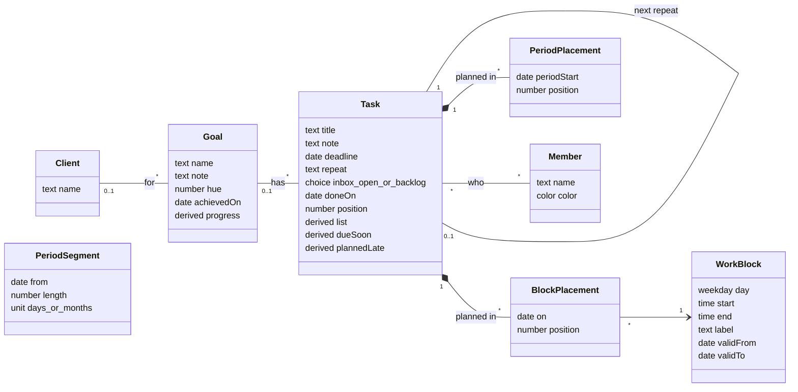

# JAPT design (Just A Planning Tool)

How JAPT works and why: users and hosting, the data model, the rules, and how the app can change while the database keeps its data. It is read from the interaction mockup (`docs/JAPT_userinteraction_mockup.html`). The mockup shows what the user sees and does; this file says what the real software stores and decides.

**Status: agreed, ready to build.** Items marked **Assumption** follow JAFT or the mockup unless you say otherwise.

## 0. Decisions so far

- **Meetings** are read, read-only, from the shared kSuite (Infomaniak) agenda through its shareable link. The link is a setting in Beheer, never in the code. One team agenda for now; the model leaves room for one agenda per person (see *Possible future*).
- **Offline adding to the Inbox:** prepared now (see *Inbox*), built later (see *Possible future*).
- **Users** are the same as JATL and JAFT: own Supabase project, invited users, access list. Beheer only sets name and colour.
- **Deleting** goes to a Bin for 30 days, as in JAFT, instead of the mockup's "Definitief verwijderen".
- **Look:** three themes as in JAFT (Orville licht default, Orville donker, Neutraal), chosen per device.
- **Name:** JAPT, Just A Planning Tool. The interface title is *JAPT*, not the mockup's *Weekplanner*.
- **Planning in the past** is allowed; the task is then checked off automatically (see *Planning*).
- **Who and when:** every record stores `created by/at` and `changed by/at`, as in JAFT.
- **A new task has nobody on it** unless you choose someone, as in the mockup. Putting your own name on it automatically is a possible future step.
- **Analysis export** for an AI, as in JAFT, in Beheer.
- **No planning history:** a task taken out of a past block is simply gone from that day.

- **Colleagues' changes** are loaded when the app opens, when the tab comes back into view, and when you move to another day, week or period (see *Working at the same time*). Live updates are *Possible future*.

## 1. Users, accounts and hosting

**Assumption:** as in JAFT.

- **Users:** a small agency team. Everyone sees and changes everything. No roles.
- **Database:** its own Supabase project, EU region, free plan. Row Level Security on every table, self-registration off, users are invited, and every rule checks "logged in and on the access list" (`members.allowed`).
- **Swappable data layer:** the app talks to one data layer (`data-service.js`). Local storage for testing, Supabase in production. Which one follows from the address (`productionHosts` in `config.js`), so testing never reaches the real database.
- **Hosting:** static files, no build step, GitHub Pages. Branch `dev` for work, `main` is live.
- **Personal view settings stay on the device:** current view (Taken, Doelen, Inbox), calendar mode, grouping, filters, folded lists, hidden sidebar. They are not shared and not in the database.

## 2. Backups

**Assumption:** as in JAFT. A backup export in Beheer (everything as one JSON file, date of last export shown) and `tools/restore.html` to turn a backup into SQL. The free Supabase plan has no restorable backups.

## 3. Language

- Code, database, identifiers and fixed values are English.
- The interface is Dutch. All interface text lives in `i18n/nl.js`; the code uses keys.
- What users type (task titles, notes, goal and client names, block names) is data and stays as typed.

## 4. Domain model

### Classes

`derived` means calculated, never stored.

### Database tables (proposal)

Every table also has `created_by`, `created_at`, `changed_by` and `changed_at`; tasks, goals and clients also have `deleted_at` for the Bin.

| Table | Holds |
|---|---|
| `members` | The users: name, colour, `allowed`. |
| `clients` | Clients, by name. A goal without client is *Intern*. |
| `goals` | Name, note, colour (`hue`), client or none, `achieved_on`. |
| `tasks` | Title, note, goal (empty only while in the Inbox), `stage` (`inbox`, `open`, `backlog`), `done_on`, deadline, repeat (`3:m`), `next_task_id` for the repeat it made, `position` for the manual order. |
| `task_members` | Who is on a task: none, one or more. |
| `work_blocks` | The standard week: weekday, start and end (minutes), optional name, `valid_from` and `valid_to`. A change makes a new row from today, so past weeks stay as they were. |
| `block_placements` | A task in a block on a date (`date`, `block_id`, `task_id`, `position`). This is the mockup's `S.plan['2026-11-04|wo-vm']`. |
| `period_segments` | The work period setting: from, length, unit. A change is a new segment from a future date. |
| `period_placements` | A task in a work period, without day or hour (`period_start`, `task_id`, `position`). The mockup's `S.plan['cy@2026-11-02']`. |
| `calendars` | The agendas meetings come from: name, link (`url`) and `owner` (empty = the team). Set in Beheer. Readable only by members on the access list. One row for now. |
| `app_settings` | Shared settings: first day of the week, deadline reminder days, work period on or off. |
| `schema_migrations` | Which migrations have run. |

## 5. Rules

### Which list a task is in

Calculated, in this order: **Gedaan** if done; **Ingepland** if it has a block placement or a placement in an existing work period; otherwise **Backlog** or **Nog niet ingepland** by its stage. Checking off wins wherever the task is.

### Inbox

- Only the title is needed. Note, goal, deadline and who can come along.
- An Inbox task may have no goal. Every other task has one.
- *Verwerken*: drop a task on a goal's *In te plannen* or *Backlog*; it gets that goal and goes to that list. Checking it off works without a goal. Deleting removes it.
- *Ongedaan maken* (and Ctrl+Z) undoes the last processing steps of this session. **Assumption:** the undo history is not stored.
- **Prepared for adding without a connection** (the queue itself is *Possible future*). The first version already follows these rules, so adding the queue later changes no data and no other code:
  - Ids are made in the app, so a task exists before the database has seen it.
  - Adding to the Inbox is one self-contained save (the task and who is on it), with nothing else that has to be saved first. It goes through one function in the data layer (`addInboxTask`), which is where the queue will sit.
  - That save is *insert, or nothing if this id already exists*. Sending it twice, for example after a timeout, never makes a duplicate.
  - A task whose goal no longer exists when it arrives (binned in the meantime) lands in the Inbox without a goal instead of failing.
  - Nothing the Inbox shows right after adding depends on the database's answer.

### Goals and clients

- A new client is made by typing a new name in the goal form; the form says so before saving. Client names are unique, ignoring case.
- Deleting a client's last goal deletes the client.
- **Behaald** with open tasks asks first: check them all off, or send them back to the Inbox (without goal, out of the agenda).
- **Heropen**, or unchecking a task of an achieved goal, makes the goal open again.
- Deleting a goal with tasks asks: delete the tasks too, or send them back to the Inbox.
- Goal colours come from a fixed set (never green like blocks or purple like periods). A new goal gets the least used colour.

### Planning

- A task can be in several blocks and several work periods.
- **Within one work period** a task is either in the period itself or on fixed days, never both. The new place wins.
- Dropping in a block where the task already is changes only the order. The top task is the most important.
- Manual order exists in Nog niet ingepland, Backlog, each block and each period.
- Dropping on Nog niet ingepland or Backlog takes the task out of all blocks.
- **Planning in the past checks the task off.** Dropping a task in a block on a day before today, or in a work period that ended before today, marks it done; it shows crossed out there. `done_on` is that day (for a work period, its last day), not the day you dragged it, so the past shows when the work happened. Unchecking it afterwards is allowed and follows the normal unchecking rules. **Assumption:** the date and the work-period case.
- **Other placements stay.** A task that is also planned on other days, or in later blocks, keeps those placements when it is checked off this way; being done, it shows crossed out there too. JAPT doesn't clean this up: what to do with the other placements is up to the user. They can uncheck it wherever it shows. Done is one value per task, so unchecking it anywhere unchecks it everywhere, the past block included.
- **Unchecked, but only planned in the past:** the task still counts as *Ingepland* and stays in its past block. It doesn't come back to Nog niet ingepland. Accepted for now; see *Possible future*. The model already has a pure function `onlyPlannedInPast(task)` next to `isLate(task)`, so marking it later is a style, not a rule change.
- **Taking a task out of a past block** removes it from that day. No record of where it was planned is kept.

### Deadlines and repeats

- **Due soon:** a task with a deadline within *deadline reminder days* (Beheer, default 7) comes to the top of Nog niet ingepland. A backlog task comes along.
  **Assumption:** in the mockup this moves the task out of the backlog for good. In the real app it is calculated: a due-soon backlog task is *shown* in Nog niet ingepland, its stage is not changed.
- **Planned late** (planned after the deadline) is allowed, but shown.
- **Repeat:** checking off a repeating task creates the next one in the Backlog, with the first deadline after today (a late task makes no backlog of overdue repeats). Unchecking removes that next task again unless it is done.
- Editing a repeating task applies to all following times; the form says so.
- **Unchecking a task without a goal** sends it back to the Inbox, with a toast.

### Work blocks

- One standard week for the whole team. Changes apply from today; the past keeps the blocks it had. Tasks planned from today move along with a changed block.
- Blocks on one day never overlap. Times snap to quarters.
- Deleting a block, clearing a day or copying a day onto other days takes the tasks planned there from today out of the agenda, with a confirmation that says how many. The tasks themselves stay.

### Work period

- Optional. A row of periods of a fixed length (days, weeks or months) that follow each other.
- A change applies from the next period; the running period and the past stay as they were.
- **Deactivating** empties all period placements. Tasks only in a period go back to Nog niet ingepland (toast with the count); tasks also on a day stay there. Length and start date are kept.

### Working at the same time

JAPT is more likely than JAFT to be used by two people at once (planning together, one at a laptop and one on a phone).

**Needed in every option:**

- **Order is a position per task between its neighbours.** A move writes only the moved task, so two people reordering the same block never rewrite each other's whole list.
- **A save checks `changed_at`:** it only saves if nobody changed that record since it was loaded. Otherwise the app reloads it and says so. Without this, the last save wins silently.

**Decided: reload at natural moments.** Changes of others are loaded when the app opens, when the tab comes back into view, and when you move to another day, week or period. A redraw never happens in the middle of a drag or an open form, because those moments are always your own action. What it misses: two people looking at the same week at the same moment see each other's changes only at their next move; the `changed_at` check stops a save on something that changed meanwhile.

The options that were considered:

- **On reload only (as JAFT):** when the app opens. Too stale for planning together.
- **Live (Supabase Realtime)**, now *Possible future*: within a second.
  - *Database:* the followed tables are added to Supabase's change feed (one migration line each). Row Level Security also applies to the change messages, so the access list holds. Far within the free plan (200 connections at once, 2 million messages a month).
  - *Data layer:* a new `onChange(callback)` in the data-layer contract. The local version needs it too (tabs tell each other through `BroadcastChannel`), to test without Supabase. A later replacement of Supabase must offer it as well.
  - *Own changes come back* as messages; merging must give the same result when a change arrives twice.
  - *Missed messages are not resent* (a phone asleep, a dropped connection). On reconnect and when the tab comes back into view, the app reloads everything anyway, so *live* comes on top of *middle*, it doesn't replace it.
  - *Interface:* a redraw must wait while you drag (it would remove the card under the mouse), must not overwrite an open task or goal form, and the form must say so when its task was deleted meanwhile. The open task card, the Inbox undo and the confirmation panels each need that check.

### Meetings

- **Read-only.** JAPT never writes to the agenda. Meetings are shown, not planned on: they are not tasks and cannot be dragged.
- **The link is a setting** in Beheer (*Agenda*), stored in `calendars`, never in the code. Anyone with the link reads the whole agenda, so it is readable only by members on the access list, and the field says so. Changing the link takes effect at once.
- **The browser reads the agenda directly.** Checked on 7 November 2026: the kSuite link answers with `content-type: text/calendar` and `access-control-allow-origin: *`, so a page on another site may read it. No server code is needed.
- **Repeating meetings** are stored once in the agenda file with a rule ("every Monday") and exceptions. The app turns them into dates for the visible days with an existing library (**Assumption:** `ical.js`, pinned version, from a CDN as JATL loads its Supabase client). Times are shown in Belgian time.
- **When:** read when the calendar opens and again after 10 minutes, kept in memory only. Nothing is stored in the database.
- **When it fails** (no connection, link changed, kSuite stops allowing it): the calendar shows the blocks without meetings and a quiet line "Agenda niet bereikbaar". Should kSuite ever drop the `access-control-allow-origin` header, a small Supabase Edge Function that fetches the link for the app is the fallback; nothing else changes.
- **Hour range:** the calendar runs from the earliest block or meeting to the latest, at least 8:00 to 18:00, as in the mockup.
- **Whole-day items** (holidays, birthdays) are left out: the calendar shows hours, and they would cover the work blocks. **Assumption.**
- **A meeting running past midnight** is shown until the end of its first day.
- **Locally** (testing) the meetings come from the test data. A link entered in the local version is read too, which is harmless because JAPT only reads.

### Bin

- **Goes to the Bin:** a task (also from the Inbox), a goal, a client that loses its last goal. Kept 30 days, then gone.
- **Together in, together out:** a goal deleted with *Taken ook verwijderen* goes to the Bin with its tasks and is restored with them. Tasks sent *terug naar de Inbox* are not in the Bin.
- **Restoring a task** puts it in Nog niet ingepland, or in the Inbox if its goal is gone. Its old block and period placements are not restored, because those days may have passed. **Assumption.**
- **Restoring a goal** of a binned client restores the client too.
- **The confirmation text changes** from "Zeker? Definitief verwijderen" to "Zeker? Naar de prullenbak", and a toast offers *Ongedaan*.
- **One place hides binned records:** the data layer doesn't load them. Only the Bin in Beheer asks for them.

### Users

- Deleting a user takes them off every task, after a confirmation with the count.
  With logins, adding a user happens in Supabase (invite); Beheer sets name and colour. Removing a user is taking them off the access list, done by the owner in the database. **Assumption:** their name stays on old tasks; *Verwijder* in Beheer only takes them off open tasks.

### Filters

- Search, Wie, Doel and Klant. OR within one filter, AND between filters. The sidebar and the list view share them.
- Achieved goals cannot be a filter. In the calendar, tasks that don't match are dimmed, not hidden.

### Analysis export

- In Beheer, next to the backup: one JSON file meant to be read by an AI, as in JAFT.
- **Assumption on contents:** one block per goal with its client, note, achieved date and its tasks; per task the title, note, who (names), deadline and repeat, done date, current list, and every day and work period it is planned in. Plus the work blocks per week, the work period setting and the export date. Readable labels instead of codes, free text as typed.
- **Left out:** the Bin and the meetings (they belong to the agenda, not to JAPT).

## 6. Interface decisions (from the mockup)

- **Views:** Taken (calendar with Dag, Werkweek, Week, Werkperiode, Lijst), Doelen, Inbox. Beheer is a dialog with Werkblokken, Werkperiode, Deadlines, Week, Gebruikers, and (new) Agenda (the agenda link), Prullenbak, Weergave (theme), Back-up with the analysis export, and the app and database version.
- **Phone:** opens on the Inbox; Taken shows the Lijst. Swiping changes day or week. Week views ask to turn the phone (no forced landscape).
- `#inbox` in the address opens the Inbox, for a bookmark on the way.
- Checking off sometimes shows a small figure (30 %, never with reduced motion). Kept as in the mockup.
- **Assumption:** the mockup's screens, labels and behaviour are the specification. The code is rebuilt cleanly, the CSS can largely be reused.

## 7. Testing

- The mockup's data becomes `tests/testdata.js`, extended with a believable history: many tasks, long titles, past weeks with changed blocks, repeats, an achieved goal, an empty week.
- Pure logic (which list, periods, repeats, block validity) lives in `model.js` without DOM or database, with tests.
- Local storage first, as with JATL and JAFT. Supabase follows once the local version behaves like the mockup.

## 8. Possible future

Not built, but prepared for. Each can be added without changing the data that exists by then. The README lists the same items.

- **Mark tasks only planned in the past:** an open task whose blocks and work periods all lie in the past turns red, the same way as a task planned after its deadline. Prepared by `onlyPlannedInPast(task)` in the model and the same CSS hook as `late`.
- **Your own name on a new task:** a task you add gets your name by default (you can remove it). Only the form's starting value changes; `task_members` already holds it.
- **Individual work blocks:** each person their own blocks, planning a task in your block puts your name on it. The full design is in the comment at the top of the mockup's script (two ways of working, shared or personal work period, switching). Prepared by an optional `owner` on `work_blocks` (empty = team); the placement key (date and block) doesn't change.
- **One agenda per person:** each member links their own agenda; meetings show in their colour, and with individual work blocks only in their own calendar. Prepared by `owner` on `calendars`; Beheer gets one link field per person.
- **Installable app (PWA)** with orientation set in the manifest, so week views can open in landscape without the full-screen trick the mockup switched off.
- **Adding to the Inbox without a connection.** The Inbox is used on the way (`#inbox` bookmark), so a missing connection matters more here than in JAFT. The rules under *Inbox* already prepare for it. What it takes:
  - *A queue on the phone:* `addInboxTask` keeps new tasks in the browser's storage and sends them once there is a connection, and when the app starts. A small line shows "2 nog niet verstuurd". An expired login keeps the queue waiting until you log in again.
  - *A service worker* that keeps the app's own files (never the data) on the phone, so JAPT opens without a connection. Without it, offline adding only works when JAPT was already open in a tab, and phones often reload a tab in the background. It is the same piece as the installable app above, so both are built together. Every release then also updates the service worker's file list; the version check catches a phone that keeps an old copy.
  - *Only adding.* Editing or planning offline would need rules for conflicts with colleagues first, a much bigger step.
- **Live updates** (Supabase Realtime): changes of colleagues within a second instead of at the next move. What it takes is described under *Working at the same time*; the position numbers and the `changed_at` check are already in place.
- **A second interface language:** all text is already in `i18n/nl.js` by key; it takes a second file and a choice in Beheer.
