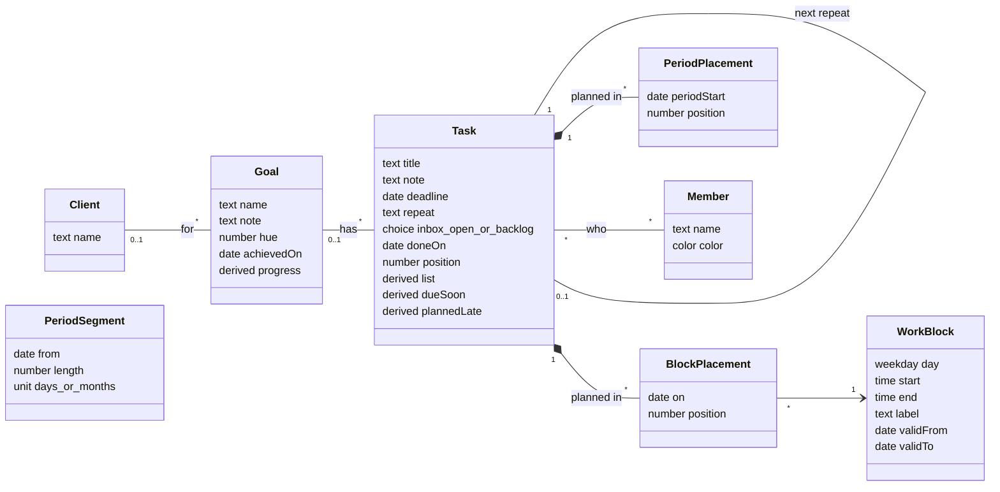

# JAPT design (Just A Planning Tool)

How JAPT works and why: users and hosting, the data model, the rules, and how the app can change while the database keeps its data. It is read from the interaction mockup (`docs/JAPT_userinteraction_mockup.html`). The mockup shows what the user sees and does; this file says what the real software stores and decides.

**Status: live and in use.** Items marked **Assumption** follow JAFT or the mockup unless you say otherwise.

## 0. Decisions so far

- **Meetings** are read, read-only, from the shared kSuite (Infomaniak) agenda through its shareable link. The link is a setting in Beheer, never in the code. One team agenda for now; the model leaves room for one agenda per person (see *Possible future*).
- **Offline adding to the Inbox:** prepared now (see *Inbox*), built later (see *Possible future*).
- **Users** are the same as JATL and JAFT: own Supabase project, users added by the owner, access list. Beheer only sets name and colour.
- **Teams are in the database from the first migration** (decided 2026-11-09). JAPT starts with one team, Orville, and nothing changes in what you see. If it is opened up later, it grows in many small teams; the data is ready for that. See *Teams*.
- **Deleting** goes to a Bin for 30 days, as in JAFT, instead of the mockup's "Definitief verwijderen".
- **Look:** three themes as in JAFT (Orville licht default, Orville donker, Neutraal), chosen per device.
- **Name:** JAPT, Just A Planning Tool. The interface title is *JAPT*, not the mockup's *Weekplanner*.
- **Planning in the past** is allowed; the task is then checked off automatically (see *Planning*).
- **Who and when:** every record stores `created by/at` and `changed by/at`, as in JAFT.
- **A new task has nobody on it** unless you choose someone, as in the mockup. Putting your own name on it automatically is a possible future step.
- **Analysis export** for an AI, as in JAFT, in Beheer.
- **No planning history:** a task taken out of a past block is simply gone from that day.
- **Photos on a task** (decided 2026-11-11): part of the note, taken or pasted without leaving JAPT, stored small in the database itself (see *Photos*).

- **Colleagues' changes** are loaded when the app opens, when the tab comes back into view, when you move to another day, week or period, and every 20 seconds while the app is in view (see *Working at the same time*).

## 1. Users, accounts and hosting

**Assumption:** as in JAFT.

- **Users:** a small agency team. Everyone in a team sees and changes everything of that team. No roles.
- **Database:** its own Supabase project, EU region, free plan. Row Level Security on every table, self-registration off, users are added by the owner, and every rule checks "logged in and on the access list of the team this row belongs to" (`members.allowed`, see *Teams*).
- **Swappable data layer:** the app talks to one data layer (`data-service.js`). Local storage for testing, Supabase in production. Which one follows from the address: the addresses in `deployment.js` use the real database, your own computer or network uses local data unless the address ends in `?db=live`, and any other address refuses to start, so a forgotten address can't look as if it works while saving in one browser only. Everything that differs per installation is in `deployment.js`, so someone can run the same code on their own database, or on another backend by writing one data layer. What that layer must do is in `docs/data-layer.md`, and `tests/contract.js` checks it.
- **Hosting:** static files, no build step, GitHub Pages. Branch `dev` for work, `main` is live.
- **Personal view settings stay on the device:** current view (Taken, Doelen, Inbox), calendar mode, grouping, filters, folded lists, hidden sidebar. They are not shared and not in the database.

## 2. Backups

**Assumption:** as in JAFT. A backup export in Beheer (everything of your team as one JSON file, date of last export shown) and `tools/restore.html` to turn a backup into SQL for one team, all or nothing. It goes into an empty team, or, when you choose to replace, wipes the team in the same transaction, so a failed restore never leaves a team empty. People are matched to someone in the team by login or else by name, since a new project has new logins. The free Supabase plan has no restorable backups.

## 3. Language

- Code, database, identifiers and fixed values are English.
- The interface is Dutch. All interface text lives in `i18n/nl.js`; the code uses keys.
- What users type (task titles, notes, goal and client names, block names) is data and stays as typed.

## 4. Domain model

### Classes

`derived` means calculated, never stored.

### Database tables

As built in `migrations/001_initial.sql`. Keys are `(team_id, id)`, ids are made in the app. Every table except `teams` and `schema_migrations` has `team_id`. Every table also has `created_by`, `created_at`, `changed_by` and `changed_at`; tasks, goals and clients also have `deleted_at` for the Bin.

| Table | Holds |
|---|---|
| `teams` | The teams: name. One row to start with: Orville. |
| `members` | A person in a team: `user_id` (the login), name, colour, `allowed`. Someone in two teams has two rows, so a name and colour per team. `members.id` is not the login id. |
| `clients` | Clients, by name. A goal without client is *Intern*. |
| `goals` | Name, note, colour (`hue`), client or none, `achieved_on`. |
| `tasks` | Title, note, goal (empty only while in the Inbox), `stage` (`inbox`, `open`, `backlog`), `done_on`, deadline, repeat (`3:m`), `next_task_id` for the repeat it made, `position` for the manual order. |
| `task_members` | Who is on a task: none, one or more. |
| `work_blocks` | The standard week: weekday, `start_min` and `end_min`, optional name, `valid_from` and `valid_to`. A change makes a new row from today, so past weeks stay as they were. |
| `block_placements` | A task in a block on a date (`on_date`, `block_id`, `task_id`, `position`, and `part_start`, see *Meetings*). This is the mockup's `S.plan['2026-11-04|wo-vm']`. |
| `period_segments` | The work period setting: `from_date`, length, unit. A change is a new segment from a future date. |
| `period_placements` | A task in a work period, without day or hour (`period_start`, `task_id`, `position`). The mockup's `S.plan['cy@2026-11-02']`. |
| `calendars` | The agendas meetings come from: name, link (`url`) and `owner` (empty = the team). Set in Beheer. Readable only by members on the access list. One row for now. |
| `app_settings` | Settings shared within a team: first day of the week, deadline reminder days, work period on or off. One row per team and setting (key `team_id` + `id`). |
| `task_photos` | Which photos a task has: `task_id`, `width` and `height` (migration 006). Loaded with everything else, so the planning knows a task has photos and a row of them can be drawn before they are read. |
| `photo_data` | The photo itself, a JPEG as bytes (`data`), one row per `task_photos` row with the same id. Never loaded with the rest: read one at a time when a task is opened, through `task_photo()` (migration 007). Goes when its `task_photos` row goes, never changed. At most 1 MB. |
| `removed_rows` | Which rows were removed, and when, for 30 days, so a reload can ask what is gone (migration 005). Written only by the database. |
| `schema_migrations` | Which migrations have run. |

## 5. Rules

### Which list a task is in

Calculated, in this order: **Gedaan** if done; **Ingepland** if it has a block placement or a placement in an existing work period; otherwise **Backlog** or **Nog niet ingepland** by its stage. Checking off wins wherever the task is.

### Inbox

- Only the title is needed. Note, goal, deadline and who can come along.
- An Inbox task may have no goal. Every other task has one.
- *Verwerken*: drop a task on a goal's *In te plannen* or *Backlog*; it gets that goal and goes to that list. Checking it off works without a goal. Deleting removes it.
- *Ongedaan maken* (and Ctrl+Z) undoes the last processing steps of this session. **Assumption:** the undo history is not stored.
- **Prepared for adding without a connection** (the queue itself is *Possible future*). The first version already follows these rules, so adding the queue later changes no data and no other code:
  - Ids are made in the app, so a task exists before the database has seen it.
  - Adding to the Inbox is one self-contained save (the task and who is on it), with nothing else that has to be saved first. It goes through one function in the data layer (`addInboxTask`), which is where the queue will sit.
  - That save is *insert, or nothing if this id already exists*. Sending it twice, for example after a timeout, never makes a duplicate.
  - A task whose goal no longer exists when it arrives (binned in the meantime) lands in the Inbox without a goal instead of failing.
  - Nothing the Inbox shows right after adding depends on the database's answer.

### Goals and clients

- A new client is made by typing a new name in the goal form; the form says so before saving. Client names are unique, ignoring case.
- Deleting a client's last goal deletes the client.
- **Behaald** with open tasks asks first: check them all off, or send them back to the Inbox (without goal, out of the agenda).
- **Heropen**, or unchecking a task of an achieved goal, makes the goal open again.
- Deleting a goal with tasks asks: delete the tasks too, or send them back to the Inbox.
- Goal colours come from a fixed set (never green like blocks or purple like periods). A new goal gets the least used colour.
- **Progress bar** on a goal: one piece per list, as wide as its number of tasks: Gedaan green, Ingepland blue, Nog niet ingepland yellow, Backlog grey. The same lists stand in words under it, so it needs no legend. Fixed colours, not the goal's own: a list then looks the same on every goal. An achieved goal's bar is grey. A task of the goal still in the Inbox isn't counted or shown in the goal: it hasn't been processed yet. A due-soon backlog task counts under Nog niet ingepland, as the task list shows it.
- **The open goal** shows its tasks per list, as the task list does: Ingepland (by first day), Nog niet ingepland, Backlog, Gedaan (closed at first; latest first). Per task one line: check box, title, the note on at most two lines, who, and on the right the days it is planned, else its deadline. A click opens it into the card of the task list; another click closes it. Checking off works there as everywhere. *+ Taak* under Nog niet ingepland and Backlog opens the task form with this goal and that list. Folding and opened tasks last while the goal is open.
- **Dragging in the open goal** works within and between Nog niet ingepland and Backlog, exactly as in the task list filtered on that goal: it is the one order of those lists, so a task also moves among tasks of other goals that aren't shown. Ingepland and Gedaan are no targets there (planning happens in the calendar, done is the check box).

### Planning

- A task can be in several blocks and several work periods.
- **Within one work period** a task is either in the period itself or on fixed days, never both. The new place wins.
- Dropping in a block where the task already is changes only the order. The top task is the most important.
- Manual order exists in Nog niet ingepland, Backlog, each block and each period.
- Dropping on Nog niet ingepland or Backlog takes the task out of all blocks.
- **Planning in the past checks the task off.** Dropping a task in a block on a day before today, or in a work period that ended before today, marks it done; it shows crossed out there. `done_on` is that day (for a work period, its last day), not the day you dragged it, so the past shows when the work happened. Unchecking it afterwards is allowed and follows the normal unchecking rules. **Assumption:** the date and the work-period case.
- **Other placements stay.** A task that is also planned on other days, or in later blocks, keeps those placements when it is checked off this way; being done, it shows crossed out there too. JAPT doesn't clean this up: what to do with the other placements is up to the user. They can uncheck it wherever it shows. Done is one value per task, so unchecking it anywhere unchecks it everywhere, the past block included.
- **Unchecked, but only planned in the past:** the task still counts as *Ingepland* and stays in its past block. It doesn't come back to Nog niet ingepland. Accepted for now; see *Possible future*. The model already has a pure function `onlyPlannedInPast(task)` next to `isLate(task)`, so marking it later is a style, not a rule change.
- **Taking a task out of a past block** removes it from that day. No record of where it was planned is kept.

### Deadlines and repeats

- **Due soon:** a task with a deadline within *deadline reminder days* (Beheer, default 7) comes to the top of Nog niet ingepland. A backlog task comes along.
  **Assumption:** in the mockup this moves the task out of the backlog for good. In the real app it is calculated: a due-soon backlog task is *shown* in Nog niet ingepland, its stage is not changed.
- **Planned late** (planned after the deadline) is allowed, but shown. A block is late on a day after the deadline. A work period is late only when it *starts* after the deadline: a period that holds the deadline still leaves days to finish in time. (The mockup marked a period late when it *ended* after the deadline; changed on 2026-11-08.)
- **Repeat:** checking off a repeating task creates the next one in the Backlog, with the first deadline after today (a late task makes no backlog of overdue repeats). Unchecking removes that next task again unless it is done.
- Editing a repeating task applies to all following times; the form says so.
- **Unchecking a task without a goal** sends it back to the Inbox, with a toast.

### Work blocks

- One standard week for the whole team. Changes apply from today; the past keeps the blocks it had. Tasks planned from today move along with a changed block.
- Blocks on one day never overlap. Times snap to quarters.
- Deleting a block, clearing a day or copying a day onto other days takes the tasks planned there from today out of the agenda, with a confirmation that says how many. The tasks themselves stay.

### Work period

- Optional. A row of periods of a fixed length (days, weeks or months) that follow each other.
- A change applies from the next period; the running period and the past stay as they were.
- **Deactivating** empties all period placements. Tasks only in a period go back to Nog niet ingepland (toast with the count); tasks also on a day stay there. Length and start date are kept.

### Working at the same time

JAPT is more likely than JAFT to be used by two people at once (planning together, one at a laptop and one on a phone).

**Needed in every option:**

- **Order is a position per task between its neighbours.** A move writes only the moved task, so two people reordering the same block never rewrite each other's whole list.
- **Known limit of the order:** the position halves on every drop into the same gap. After about 50 drops in a row between the same two neighbours two positions become equal and those two tasks can swap. It costs no data and hardly happens in normal use. Renumbering the list would solve it, but writes many rows at once, against the point of writing only the moved task; not done for that reason.
- **Actions run one after another, whole.** A second click while the first is still on its way reads the state after the first has been saved, so it builds on what is really there and doesn't look like a change by someone else. A change by anyone else is still refused.
- **A save checks `changed_at`:** it only saves if nobody changed that record since it was loaded. Otherwise the app reloads it and says so. Without this, the last save wins silently.

**Decided: two kinds of loading, at natural moments and every 20 seconds in view.** *Everything* reads all the team's data; *changes* asks only what changed since the previous load (`changes_since`, migrations/005), about 1 kB when nothing did. Because changes cost so little, they are loaded often; everything only when there is nothing to build on.

| What you do | What the app does |
|---|---|
| Open the app | Load everything |
| Move to another day, week or period | Load changes, unless it did in the last 20 s |
| Look at the app without clicking | Load changes every 20 s |
| Switch to another tab or app, lock the phone | Nothing, as long as the app is out of view |
| Come back to the app | Load changes, unless it did in the last 20 s |
| Come back after more than 30 days | Load everything: the database keeps removals that long |
| Save something someone else changed meanwhile, or get no answer | Say so and load changes at once; a form keeps what you typed |
| Drag a task, or have a task card open | Nothing until you are done, then load changes |

The 20 seconds is `reloadSeconds` in `config.js`: how late a colleague's change shows up at most. It is a choice, not a measurement; 10 or 30 work as well. One number for both the moments and the clock, because a second number for "actively planning" would save little and need a rule for when you are active. On your own machine (the local data layer) nobody else changes anything, so nothing is loaded by the clock. A removed row leaves nothing to see, so the database notes every removal for 30 days; an app that hasn't asked for that long loads everything. The database looks 2 minutes further back than asked, so a save that was still busy at the previous load isn't missed. A redraw never happens in the middle of a drag or with a task card open; what arrives then waits until they are done. While a form or window is open the page behind it can reload, but the form itself is left alone, and it remembers the version it opened: saving compares with that version, so a reload can't make older values count as up to date. When someone else changed it, the form says so, keeps what you typed, and a second save is a conscious choice for your own version. Undo expects the row as your save left it, so it never overwrites what someone changed since. What it misses: two people looking at the same week see each other's changes up to 20 seconds late; the `changed_at` check stops a save on something that changed meanwhile.

### Meetings

- **Read-only.** JAPT never writes to the agenda. Meetings are shown, not planned on: they are not tasks and cannot be dragged.
- **The link is a setting** in Beheer (*Agenda*), stored in `calendars`, never in the code. Anyone with the link reads the whole agenda, so it is readable only by members on the access list, and the field says so. Changing the link takes effect at once.
- **The browser reads the agenda directly.** Checked on 7 November 2026: the kSuite link answers with `content-type: text/calendar` and `access-control-allow-origin: *`, so a page on another site may read it. No server code is needed.
- **Repeating meetings** are stored once in the agenda file with a rule ("every Monday") and exceptions. The app turns them into dates for the visible days with an existing library (**Assumption:** `ical.js`, pinned version, from a CDN as JATL loads its Supabase client). Times are shown in Belgian time.
- **When:** read when the calendar opens and again after 10 minutes, kept in memory only. Nothing is stored in the database.
- **When it fails** (no connection, link changed, kSuite stops allowing it): the calendar shows the blocks without meetings and a quiet line "Agenda niet bereikbaar". Should kSuite ever drop the `access-control-allow-origin` header, a small Supabase Edge Function that fetches the link for the app is the fallback; nothing else changes.
- **Hour range:** the calendar runs from the earliest block or meeting to the latest, at least 8:00 to 18:00, as in the mockup.
- **Whole-day items** (holidays, birthdays) are left out: the calendar shows hours, and they would cover the work blocks. **Assumption.**
- **A meeting running past midnight** is shown until the end of its first day.
- **A meeting during a work block** is drawn over the block, and tasks are never placed under it: you aren't free at that time. A full block makes its tasks smaller step by step, the same for every task in it: first without the client, then only the title, then also smaller. A block with a meeting in it acts as separate blocks, one per free part, each with its own room. The block's times stand once, on the first part. You choose the part by dropping a task in it; `part_start` remembers the minute that part started, which says nothing about when the task happens. A task never put in a part fills them from the top. When meetings change, a task goes to the part holding that minute, else the next part of the same block, else the last; it never moves to another block by itself. What doesn't fit moves on to the next part. A part shorter than 30 minutes doesn't count. A short part has just room for one task, under the times if it is the first. A block a meeting covers completely takes no tasks. A task that was planned in such a block, from today on, goes back to Nog niet ingepland as long as the meeting is there. This is worked out, not saved: the agenda is read-only and every browser reads it, so no browser should change the planning because of it, and if the meeting goes the task is back in its block. Planning the task somewhere else gives up the covered place. A task that also has another block stays Ingepland. In the past nothing moves: the meeting says how many tasks are behind it, and clicking that shows those tasks; a click on one shows its card, as in the calendar. Meetings that overlap each other stand side by side.
- **Locally** (testing) the meetings come from the test data. A link entered in the local version is read too, which is harmless because JAPT only reads.

### Bin

- **Goes to the Bin:** a task (also from the Inbox), a goal, a client that loses its last goal. Kept 30 days, then gone.
- **Together in, together out:** a goal deleted with *Taken ook verwijderen* goes to the Bin with its tasks and is restored with them. Tasks sent *terug naar de Inbox* are not in the Bin.
- **Restoring a task** puts it in Nog niet ingepland, or in the Inbox if its goal is gone. Its old block and period placements are not restored, because those days may have passed. **Assumption.**
- **Restoring a goal** of a binned client restores the client too.
- **The confirmation text changes** from "Zeker? Definitief verwijderen" to "Zeker? Naar de prullenbak", and a toast offers *Ongedaan*.
- **One place hides binned records:** the data layer doesn't load them. Only the Bin in Beheer asks for them.

### Users

- Deleting a user takes them off every task, after a confirmation with the count.
  With logins, adding a user happens in Supabase: a login with a password (*Create new user*), and `allowed` on in `members`; Beheer sets name and colour (README, Adding someone). Not the invitation mail: it lets someone in once, and JAPT has no screen yet to choose a password, so they couldn't log in again. Removing a user is taking them off the access list, done by the owner in the database. Inviting from JAPT itself is *Possible future*. **Assumption:** their name stays on old tasks; *Verwijder* in Beheer only takes them off open tasks.

### Teams

Decided on 2026-11-09: one shared database and one version of the software for every team, with a team on every row. A separate database per team would mean running every migration once per team.

**What the first migration does:**

- `teams`, and `team_id` on every table that holds team data. The first team isn't in a migration but in `tools/first-team.sql`, so another installation gets its own name.
- **New logins:** with exactly one team, a new login joins it automatically, but with `allowed` false: someone created by mistake can log in and sees nothing.
- **`apply_batch`** saves a group of changes all or nothing, with the rights of the user, and refuses a change on a row someone else changed since.
- **References are checked at the end of a save,** because one save may add a row and point to it in any order.
- **Row Level Security keeps teams apart:** on every table, for reading, adding, changing and deleting, the row's team must be one you are an allowed member of. It also checks the new value, so a row can't be written into another team, and `team_id` can't be changed afterwards.
- **No reference across teams:** a task can only point to a goal of its own team, and the same for every other reference (foreign keys on team and id together).
- **Unique within a team:** client and user names, and settings.
- **One narrow function may look past the rules:** `my_team_ids()` returns the teams of the person asking. It is needed because the rule on `members` can't read `members` itself. Everything else, including the function that saves a batch, runs with the rights of the user.
- Keys start with `team_id`, so reading one team is fast.

**In the code:** only the Supabase data layer knows about teams. It loads one team, adds `team_id` when it saves, and takes it off what it returns. `model.js`, the Store and the screens stay as they are, and the local version is one team without saying so. The team that is open is the first one you are a member of; choosing another is for when someone can be in two.

**Proven by a test:** two test users in two teams. On every table and function, one tries to read, add, change and delete the other's data, and one attempt that works fails the test. A second check fails when a table has no Row Level Security. Both must first be seen to fail on a rule that was removed on purpose. They run against a real Supabase database, because the local version has no such rules.

**Only what the app would send anyway gets through:** colours, ids and delete groups have a fixed form in the database, because they end up in a colleague's page; who made or changed something and when is filled in by the database for every logged-in user; emptying the Bin is one function, which first moves a task alive under a deleted goal to the Inbox.

**Not built now** (see *Possible future*): signing up, creating a team, inviting from the app, choosing between teams, paying.

### Filters

- Search, Wie, Doel and Klant. OR within one filter, AND between filters. The sidebar and the list view share them.
- Achieved goals cannot be a filter. In the calendar, tasks that don't match are dimmed, not hidden.

### Analysis export

- In Beheer, next to the backup: one JSON file meant to be read by an AI, as in JAFT.
- **Assumption on contents:** one block per goal with its client, note, achieved date and its tasks; per task the title, note, who (names), deadline and repeat, done date, current list, and every day and work period it is planned in. Plus the work blocks per week, the work period setting and the export date. Readable labels instead of codes, free text as typed.
- **Left out:** the Bin and the meetings (they belong to the agenda, not to JAPT).

### Photos

- **Part of the note, not a field of their own.** The note field holds a camera button, bottom right inside the field, and the photos as a row under the text. Every row of a form keeps the same shape (a label, then a field); a button beside the label made one row taller than the others.
- **Adding:** the camera button, as often as you like. On a phone it opens the phone's own choice (take a photo, photo library, file): taking one stays inside JAPT. On a laptop also pasting (Cmd+V, for a screenshot) anywhere in the form, and dropping a file on the note, which lights up while you drag. There is no line of text explaining this: such a line looked like a link.
- **Where:** the task form and *Toevoegen* in the Inbox.
- **Taking one off:** a × on the photo. Adding and taking off are saved with *Opslaan*, like the rest of the form; *Annuleren* undoes both.
- **Seeing:** the task card and the form show the photos as a row of small photos, 72 pixels high, in their own proportions. Large enough to tell which photo it is; to read what is on it you open it. A photo the full width of the card was tried: still too small to read a whiteboard and it made the card two to three times as tall. In the planning a task with photos shows a small mark, left out in a full block where there is no room.
- **Full screen:** a click on a photo. Close with ×, Esc or a click beside it; Esc closes the photo before the card under it. With more photos: arrows, the arrow keys, or swiping (no arrows on a touch screen). Zooming in on a phone with two fingers.
- **Size:** made smaller in the browser before saving, the long side at most 1200 pixels, JPEG quality 0.7 (`photoMaxSide`, `photoQuality` in `config.js`). About 120 kB for a photo of a whiteboard. Compared on a real whiteboard photo: 600 pixels was just readable and blurry on a tablet (the photo is stretched more than twice there); 1000 and 1200 were both readable. Drawing the photo again also leaves out what a camera writes into it, such as where it was taken. A transparent part of a screenshot becomes white.
- **Stored in the database, as bytes.** Not in Supabase Storage: a photo is then private through the same rule as everything else (only your own team), goes with its task when that is removed for good, and is in the backup. On its way in it is base64 inside the save of its task, a third larger, so a task and its photos are saved together or not at all; what is sent to Supabase doesn't count towards its limit. On its way out it is read as bytes, not as text, through `task_photo()` (migration 007): Supabase only answers with bytes when the answer has a type of its own, here `image/jpeg`. Compared: base64 kept in the database would fill it about 9 months sooner.
- **Read only when shown,** one at a time, then kept for the rest of the session. Loading the planning and reloading changes never carry photos.
- **How long the free database lasts:** 500 MB, at about 160 kB per photo with everything around it, five photos per working day: about three years. Two a day: about seven. After that the paid plan (8 GB) or clearing photos of old finished tasks. The Supabase dashboard shows the size.
- **Not carried to the next repeat:** checking off a repeating task makes the next one without its photos. Copying them would double them in the database.
- **Locally** (testing) photos are kept in the browser beside the rest, about 30 fit; a save that doesn't fit is refused.

## 6. Interface decisions (from the mockup)

- **Views:** Taken (calendar with Dag, Werkweek, Week, Werkperiode, Lijst), Doelen, Inbox. Beheer is a dialog with Werkblokken, Werkperiode, Deadlines, Week, Gebruikers, and (new) Agenda (the agenda link), Prullenbak, Weergave (theme), Back-up with the analysis export, and the app and database version.
- **Phone:** opens on the Inbox; Taken shows the Lijst, each time the app was left and you come back (not when a window was open, such as the task form you took a photo for). Another view, or a jump to the calendar, lasts until you leave the app. Swiping changes day or week. Week views ask to turn the phone (no forced landscape).
- `#inbox` in the address opens the Inbox, for a bookmark on the way.
- **The task list on the left starts closed** on a computer, so the calendar has the room; `Taken` opens it and the choice is remembered per device. On a phone it sits under the calendar and stays as it was.
- Checking off sometimes shows a small figure (30 %, never with reduced motion). Kept as in the mockup.
- **Assumption:** the mockup's screens, labels and behaviour are the specification. The code is rebuilt cleanly, the CSS can largely be reused.

## 7. Testing

- The mockup's data becomes `tests/testdata.js`, extended with a believable history: many tasks, long titles, past weeks with changed blocks, repeats, an achieved goal, an empty week.
- Pure logic (which list, periods, repeats, block validity) lives in `model.js` without DOM or database, with tests.
- Local storage first, as with JATL and JAFT, then Supabase.
- **Typed text stays text:** screens build HTML as text and pass everything people typed through `UI.esc()`. `tests/escape.html` proves it in a browser: every typed field is filled with HTML, every screen, window, picker and tab is opened (wide and phone-sized), and one real element made from typed text fails the test. It was checked to fail by removing `esc()` on purpose (in text and in an attribute). `tests/release.test.js` fails when a calendar view or Beheer tab has no step in it, and when a line of code is over 140 characters.
- **Saving is tested too:** `tests/store.test.js` runs the Store on the local data layer in node: all or nothing, undo, the `changed_at` check, and the rules that need more than one row.
- **Scripts from outside are pinned:** a script from a CDN carries an `integrity` hash, so the browser refuses a file that isn't exactly the one checked. Only files that are in the package itself: a `.min.js` jsDelivr generates can change, and the hash would then block the app for everyone. `tests/release.test.js` fails without it. The Google Fonts stylesheet can't have one, because Google serves different CSS per browser; a stylesheet can't read the login.
- **A request that hangs can't hold up the app:** every request to the database stops after `requestSeconds` (`config.js`). No answer doesn't mean not saved, so the app reloads and says so instead of "not saved"; trying again on the old screen could save the same thing twice. `tests/supabase-layer.test.js`.
- **Teams are kept apart, proven against the real database:** `tests/teams.test.js`. It was checked to fail by breaking the rule on one table and switching Row Level Security off on another.
- **Before every release:** `node tests/model.test.js`, `node tests/store.test.js`, `node tests/release.test.js`, `node tests/restore.test.js`, `node tests/contract.test.js`, `node tests/supabase-layer.test.js`, `tests/escape.html` in the browser. After a change in `migrations/`: `node tests/teams.test.js` too (setup in the README, on a separate Supabase project once JAPT is in real use).

## 8. Possible future

Not built, but prepared for. Each can be added without changing the data that exists by then. The README lists the same items.

- **Mark tasks only planned in the past:** an open task whose blocks and work periods all lie in the past turns red, the same way as a task planned after its deadline. Prepared by `onlyPlannedInPast(task)` in the model and the same CSS hook as `late`.
- **Your own name on a new task:** a task you add gets your name by default (you can remove it). Only the form's starting value changes; `task_members` already holds it.
- **Individual work blocks:** each person their own blocks, planning a task in your block puts your name on it. The full design is in the comment at the top of the mockup's script (two ways of working, shared or personal work period, switching). Prepared by an optional `owner` on `work_blocks` (empty = team); the placement key (date and block) doesn't change.
- **One agenda per person:** each member links their own agenda; meetings show in their colour, and with individual work blocks only in their own calendar. Prepared by `owner` on `calendars`; Beheer gets one link field per person.
- **Installable app (PWA)** with orientation set in the manifest, so week views can open in landscape without the full-screen trick the mockup switched off.
- **Adding to the Inbox without a connection.** The Inbox is used on the way (`#inbox` bookmark), so a missing connection matters more here than in JAFT. The rules under *Inbox* already prepare for it. What it takes:
  - *A queue on the phone:* `addInboxTask` keeps new tasks in the browser's storage and sends them once there is a connection, and when the app starts. A small line shows "2 nog niet verstuurd". An expired login keeps the queue waiting until you log in again.
  - *A service worker* that keeps the app's own files (never the data) on the phone, so JAPT opens without a connection. Without it, offline adding only works when JAPT was already open in a tab, and phones often reload a tab in the background. It is the same piece as the installable app above, so both are built together. Every release then also updates the service worker's file list; the version check catches a phone that keeps an old copy.
  - *Only adding.* Editing or planning offline would need rules for conflicts with colleagues first, a much bigger step.
- **Sharing a photo to JAPT** (Android): JAPT in the phone's share menu, opening *Toevoegen* with the photo ready. It needs the app installed (*App installeren* in Chrome) and a small service worker that only catches the shared photo, because GitHub Pages can't receive it; keeping no files of the app, it can't leave an old version behind. iPhone doesn't let a web app into the share menu.
- **Inviting someone from JAPT** instead of adding them in the database. Three parts, each useful on its own:
  - *A password in JAPT:* a screen *Kies je wachtwoord* that takes the link from an invitation mail, and *wachtwoord vergeten* and *wachtwoord wijzigen*. Only the app changes (Supabase Auth does the rest); from then on the invitation mail in Supabase works.
  - *Access in Beheer > Gebruikers:* switching `allowed` on and off there instead of in the table. A migration lets a member change the access of others in the same team, never leaving a team without anyone who has access.
  - *Inviting from Beheer:* typing an email address in JAPT. Sending an invitation needs Supabase's secret key, which can never be in the app, so it takes a small function on Supabase (an Edge Function) that sends it, only for someone with access to that team. The first piece of JAPT that doesn't run in the browser.
- **A second interface language:** all text is already in `i18n/nl.js` by key; it takes a second file and a choice in Beheer.
- **More users: many small teams, not bigger teams.** If JAPT is ever opened up, it grows in the number of teams, each with one or a few people: an agency or a freelancer, and many of those. The use case is not the multinational, so no departments, no levels of organisation and no thousands of people in one planning. A freelancer is a team of one, not a special case.
  The data is prepared for it (see *Teams*): every row has a team, and teams are kept apart. What it still takes: signing up and creating a team, inviting from the app, choosing between teams for someone in two, paying, a paid database plan, loading only recent data instead of everything, the Bin emptied by the database instead of by each browser, migrations that keep working while old tabs are open, and hosting other than GitHub Pages, which isn't meant for running a business.
